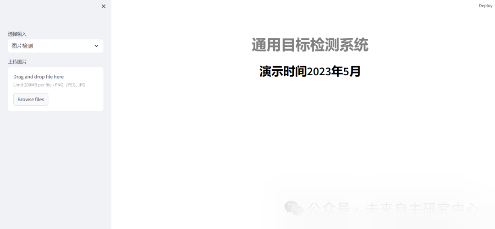
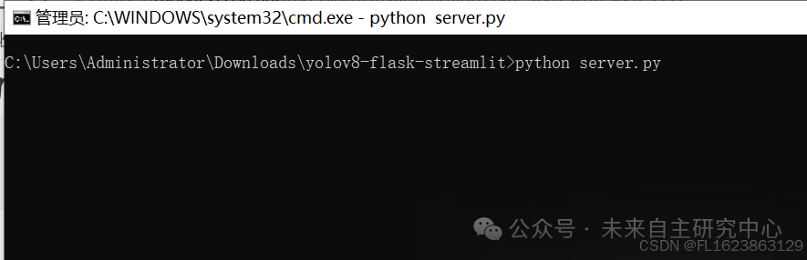
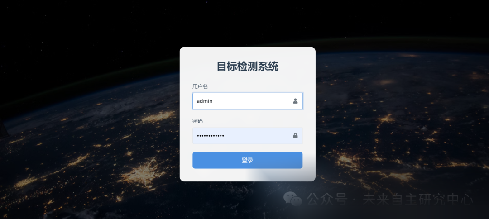

# Implementing a Target Detection System with a Beautiful Login Interface Based on Yolov8+Streamlit

[Project Introduction]

The target detection system based on YOLOv8 and Streamlit, integrating the advanced target detection capabilities of YOLOv8 with the rapid construction of interactive web applications advantages of Streamlit, provides a powerful and easy-to-operate target detection platform for users. This system not only possesses high-precision target detection functions but also has a beautiful and intuitive login interface, greatly enhancing the user experience.

The login interface is the first step users take to interact with the system, and its design is crucial. The system employs a simple and clear layout, placing the login box prominently on the page to ensure users can quickly locate and complete the login process. Additionally, the interface incorporates color coordination and icon elements, making the entire interface both visually appealing and modern.

During the login process, the system provides friendly prompts to guide users in correctly entering their username and password. Additionally, to ensure system security, a captcha function has been incorporated, effectively preventing malicious attacks and automated scripts from gaining access.

Upon successful login, users will be taken to the main interface of the target detection system. Here, users can upload images or videos, and the system will use the YOLOv8 model to perform object detection on the uploaded files. The results are presented in an intuitive manner, including detection boxes, category labels, and confidence scores among other information. Users can also adjust detection parameters as needed, such as confidence thresholds, to achieve more accurate detection results.

The entire system is not only powerful but also user-friendly and visually appealing. Whether it's for professionals or regular users, it can be easily mastered and quickly accomplishes target detection tasks. In summary, the target detection system based on YOLOv8 and Streamlit features a beautiful and practical login interface, providing users with an efficient, secure, and convenient platform for target detection.

[Test Environment]
Windows x64
Anaconda3 + Python3.8
PyTorch==2.3.0
Ultralytics==8.3.81
Streamlit
[Running Steps]
After installing the environment, there are two modes to choose from, set according to your preference.
Start running without a login interface:
streamlit run main.py

Then copy the prompt address to the browser and you can see the interface. Select the corresponding operation to operate.

Running with login interface:
Start the service
python server.py

Do not close this window at this time. If it keeps stuck, it means the startup is successful.
Starting login:
python login.py

Entering the login interface:

Enter username: admin, password: admin. After successful login, display

## Payment

Here is a pay link on Stripe ( https://buy.stripe.com/3cs8yP7sY87d0vu9AB ). Please contact me lonlonago@foxmail.com after funding $89, and I will send you a complete data files , thank you!

